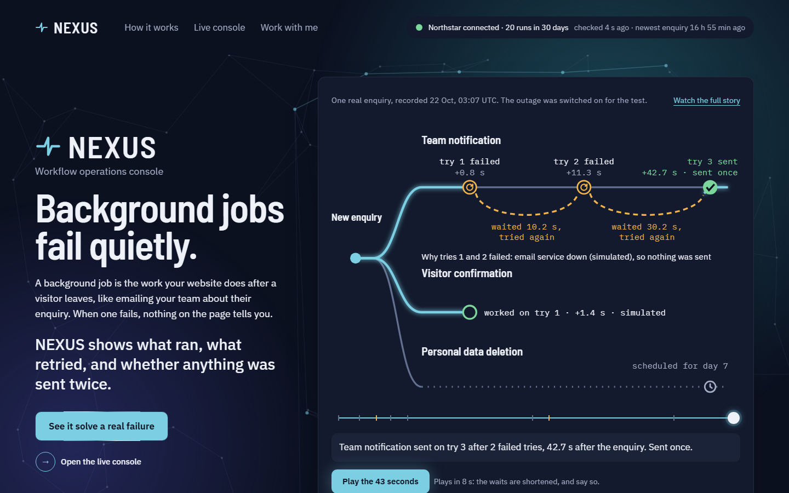
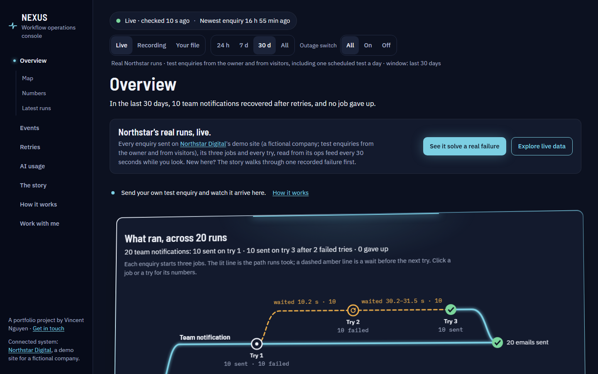
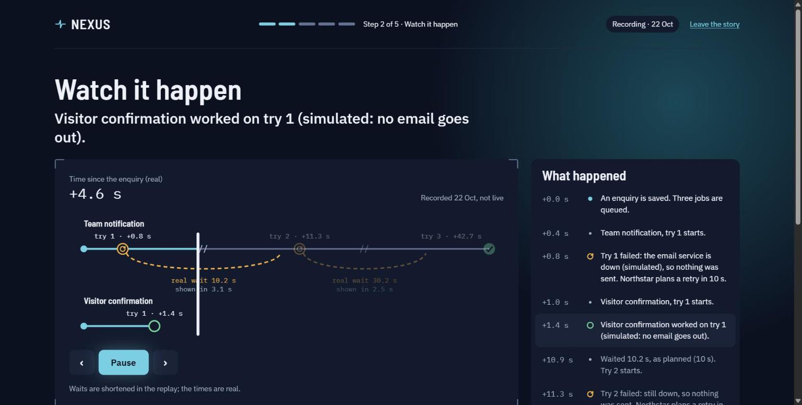
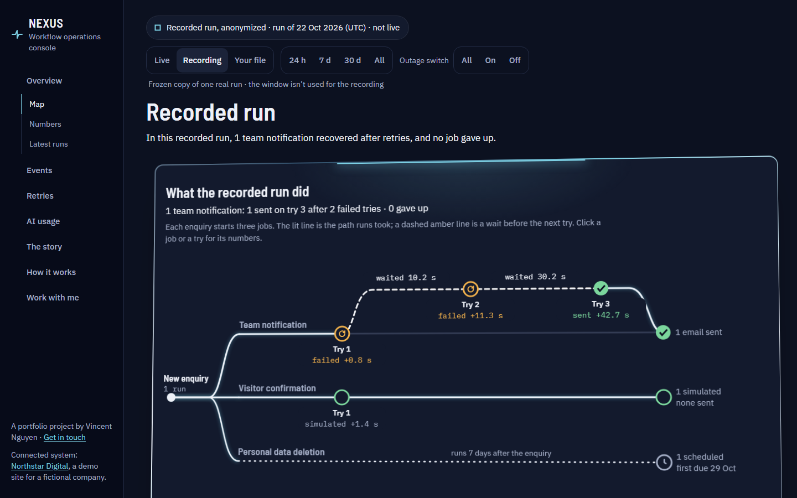
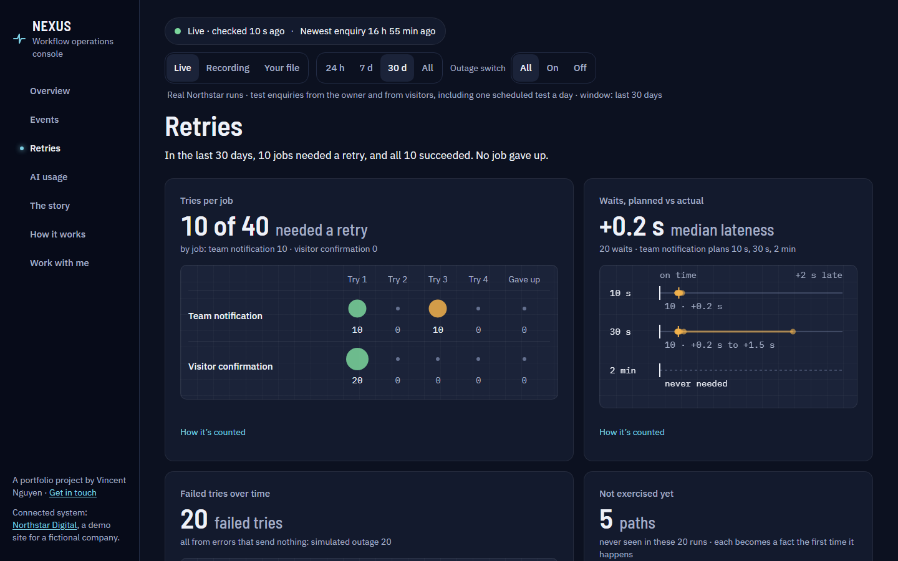
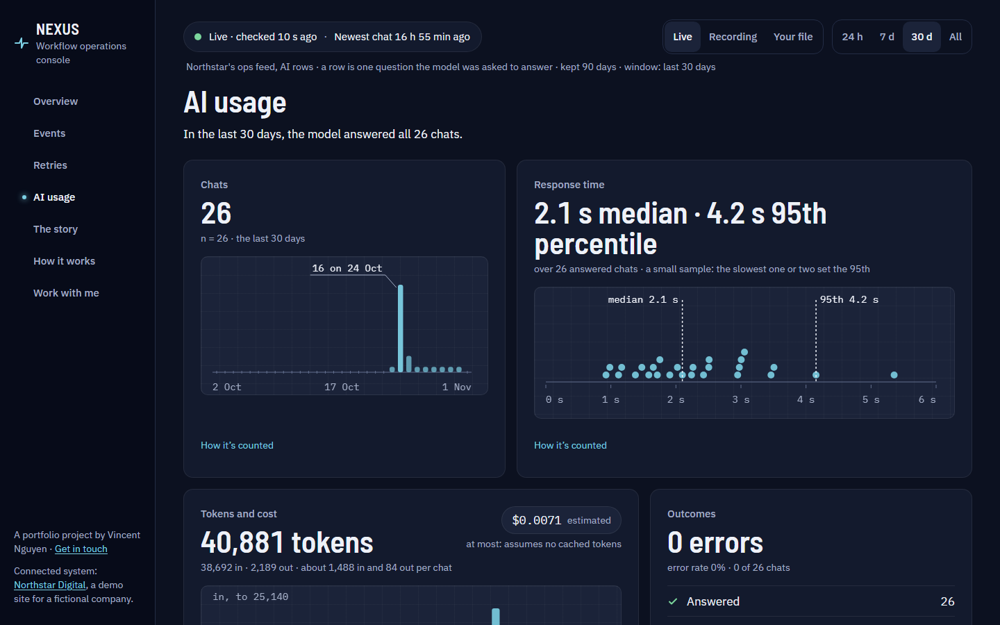
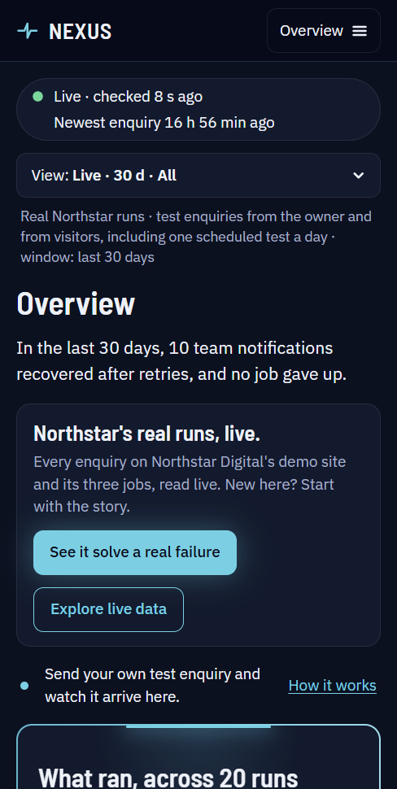

# NEXUS

**A workflow operations console.** Web apps hand follow-up work to background jobs (email the team, retry when the
email service is down, delete personal data a week later), and those jobs fail quietly: nothing on the page tells
anyone. NEXUS reads the events the jobs record and shows what ran, what retried, and whether anything was sent twice,
with the numbers behind every claim.

**Connected now: [Northstar Digital](https://northstar-demodigital.netlify.app)**, a demo agency site (a fictional
company) with a real backend. Each enquiry sent through its contact form starts three jobs. NEXUS knows none of them
by name: it draws whatever the feed describes.

**Live:** https://nexus-democonsole.netlify.app



## What's real here
- **The data is real Northstar traffic**: test enquiries from the site's owner and from visitors, including one
  scheduled test enquiry and one test chat a day (Northstar's `demo-traffic.yml`). Nothing is generated in the browser.
- **The failures are on purpose**: an "outage switch" on an enquiry makes the team email's first two tries fail. They
  send nothing, Northstar waits 10 s and 30 s, and try 3 sends the email once.
- **The recording** (the story, the hero, the console's Recording) is one real run from 22 Oct 2026, anonymized and
  frozen into the repo, so it works even when Northstar sleeps.
- **The visitor confirmation is simulated** (no email goes out), and the console says so wherever it appears.

## The pages
| Page | What it does |
|---|---|
| [`/`](https://nexus-democonsole.netlify.app/) | The pitch, the recorded run playing in 43 seconds, Northstar's last 30 days in four numbers, three ways in |
| [`/how`](https://nexus-democonsole.netlify.app/how) | The same run as raw feed, timeline and numbers; how NEXUS connects; the console's own pieces; questions |
| [`/story`](https://nexus-democonsole.netlify.app/story) | Five beats about one recorded failure: you guess first, then see the evidence |
| [`/console`](https://nexus-democonsole.netlify.app/console) | The live console: overview (map, numbers, latest runs), events, retries, AI usage; live data, the recording or your own file. Send your own test enquiry on Northstar and watch it arrive |
| [`/connect`](https://nexus-democonsole.netlify.app/connect) | The feed contract: every field, its limits, an adapter guide, and a sample to try |
| [`/work`](https://nexus-democonsole.netlify.app/work) | Who built it, and what I can build for you |



| | |
|---|---|
|  |  |
|  |  |



Screenshots taken on 1 Nov 2026 from the live feed (20 runs in the last 30 days).

## How it reads any system
NEXUS reads one JSON feed. The feed describes its own workflow (its jobs, their tries and waits, what each result
means, which errors send nothing, its test switches), and NEXUS draws from that description, not from code that knows
Northstar. `generic.test` fails if a Northstar job, result or flag name appears in app code, and `otherWorkflow.test`
runs a made-up shop through the same code. The contract, with every field and limit, is on
[`/connect`](https://nexus-democonsole.netlify.app/connect); you can load your own file there, or the sample shop.

## How it's built
- **Vite, React 19, TypeScript (strict), Tailwind CSS 4, Vitest.** Fonts self-hosted with Fontsource. Hosted on
  Netlify, CI on GitHub Actions (typecheck, lint, tests, build).
- **No router, data or chart libraries.** URL state in a small hook, a DOM-free poller, and every chart hand-drawn in SVG.
- **The logic is pure.** `src/lib/` (51 modules) is DOM-free: metrics, the map's model and geometry, the replay, the
  story, the explainers' words. Components only render it.
- **Honest numbers.** Every rate shows its n; below a minimum it says why and how far it is from one; a cut-off window
  withholds metrics instead of guessing; "sent once" means exactly one recorded send.
- **Polling that respects free tiers.** Every 30 s while the tab is visible, every 2 min after 5 min without input,
  paused after 30 min. Only the production site asks Northstar: a deploy preview sends nothing and says why.
- Gzip sizes: 70.5 kB shared, 22.3 kB the landing pages, 32.4 kB the console, 7.8 kB the story, 12.4 kB CSS.

## Quality
- **723 tests in 53 files** (1 Nov 2026), including the colour contrast of every token pair and chart mark, the
  vocabulary the UI may use, and the feed contract checked against the parser both ways.
- **Accessibility:** Lighthouse accessibility 100 on all 26 reports (13 pages, mobile and desktop); a screen-reader
  pass with NVDA, keyboard-only and reduced-motion runs, forced colours, 320 px reflow. Findings, fixes and the
  before/after numbers: [docs/accessibility.md](docs/accessibility.md).
- **Operations:** what each free tier costs, what a visitor sees when a service is down, and who gets told, in
  notes kept with the private working repo.

## Run locally
Requires Node 24 (see `.nvmrc`).

```sh
npm ci
npm run dev        # http://localhost:5173; the feed goes through a Vite proxy (Northstar's CORS allows only production)
npm run typecheck
npm run lint
npm test
npm run build      # output in dist/; `npm run preview` serves it, and shows the preview state (no live data)
```

## Project docs
[docs/plan.md](docs/plan.md) (the approved spec) · [docs/roadmap.md](docs/roadmap.md) (the phases and the limits
each answers) · [docs/checkpoint-a.md](docs/checkpoint-a.md), [docs/checkpoint-b.md](docs/checkpoint-b.md) (watching
real people use it) · [docs/accessibility.md](docs/accessibility.md).
They are the working record: the commit ids, the working notes (CLAUDE.md) and the operations notes (docs/operations.md) they mention belong to the private
repository the project is built in; this one is published from it at review points.

## Author
NEXUS is a portfolio project by **Vincent Nguyen**, available for freelance web development, AI integration and
automation. Built with AI-assisted development tools; the product, design and engineering decisions, and every
review, are Vincent's. Get in touch: [vincent.cao.nguyen.work@gmail.com](mailto:vincent.cao.nguyen.work@gmail.com) ·
[GitHub profile](https://github.com/vincent-nguyen-dev)

**All rights reserved.** The code is public to read and review, not to reuse.
